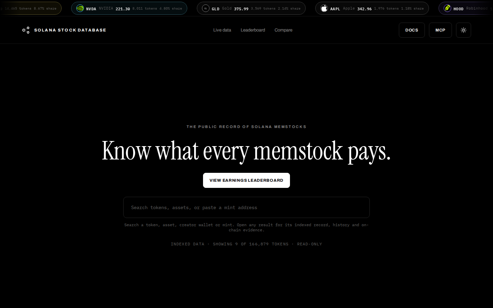
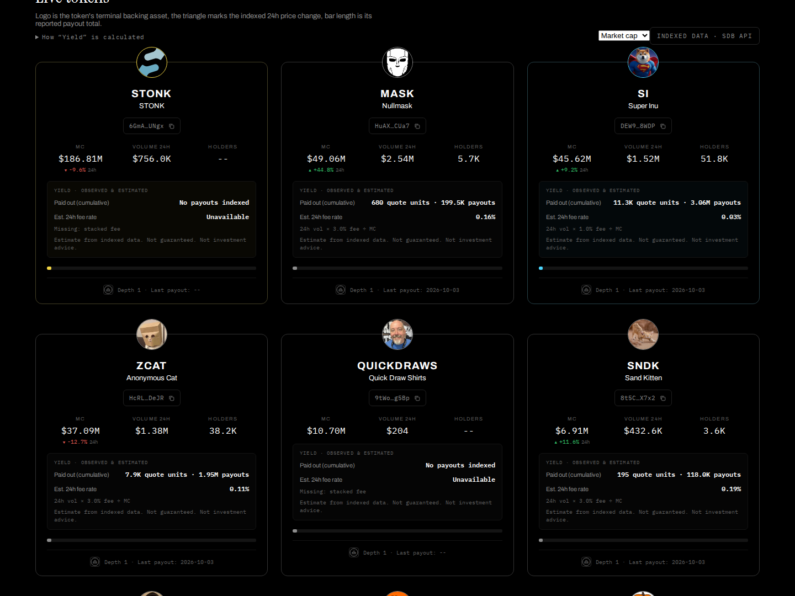

# Solana Stock Database (SDB)


<p align="center"></p>

<p align="center"><a href="https://solanastockdatabase.com">Live site</a> &middot; <a href="docs/rpc-strategy.md">RPC strategy</a> &middot; <a href="bench/RESULTS.md">Benchmark</a> &middot; <a href="LICENSE">MIT</a></p>

## What you get

<p align="center"></p>

- Live index of StonkFun memstocks with market cap, volume, holders and indexed payouts.
- Stock cards for every backing asset (SPY, NVDA, GLD, AAPL and more).
- Read-only HTTP API and MCP server for agents.
- Runs on the Helius free plan with credit accounting per method.

## Overview

SDB indexes Solana memstock and stock-token activity. It stores observations and history in a local SQLite database. It serves that data over REST and MCP.

SDB is read-only. It is not a wallet or trading system.

## How it uses Helius

SDB runs on the Helius free plan. The onchain step reads holders, supply, signatures and transactions for the top tokens by market cap. The Meteora DBC collector reads pool and config accounts with `getProgramAccountsV2`.

Signatures are read incrementally with a stored cursor, failed transactions are skipped, and pool owners refresh once a day. In the synthetic benchmark this cuts onchain credits by 71% at low activity and 29% at high activity, with no valid event lost. See [bench/RESULTS.md](bench/RESULTS.md) and [docs/rpc-strategy.md](docs/rpc-strategy.md).

Every run records calls and credits per method. Read them at `GET /api/rpc-stats` or with the MCP tool `get_rpc_stats`. SDB does not use Helius webhooks.

## Run locally

Requires Docker Compose.

```sh
cp .env.example .env
docker compose up --build
```

Open `http://127.0.0.1:8090`. SDB creates an empty SQLite database on startup. The default Compose setup starts only the API and UI, bound to localhost.

Collection is opt-in. Enable the `collection` Compose profile after adding provider settings to `.env`. RPC use may incur provider charges.

## Tests

Tests use synthetic data.

```sh
python bench/synthetic.py
python -m unittest discover -s tests -v
npm --prefix collectors/meteora-dbc ci
npm --prefix collectors/meteora-dbc test
```

## Data and security

The repository contains source code, schema, synthetic tests, and a DBC collector. It contains no production database, API keys, wallets, or customer data. Never commit `.env` or local database files.

## License

MIT. See [LICENSE](LICENSE).
